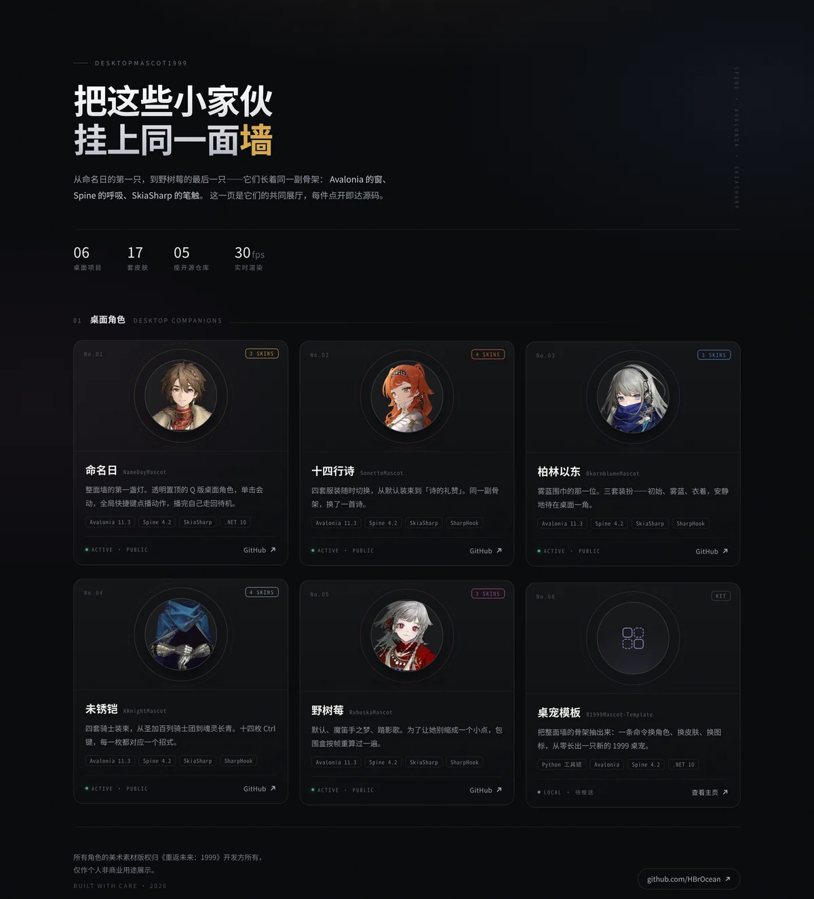

<div align="center">



<br>

# DesktopMascot1999 · 桌面角色墙

**《重返未来：1999》的六个桌面角色、十七套皮肤、五座开源仓库。**

[在线预览](https://hbrocean.github.io/DesktopMascot1999/) · [@HBrOcean](https://github.com/HBrOcean)

</div>

---

## 这是什么

同一个角色骨架，长出了五只不同的小家伙。

`index.html` 是一个**零依赖单文件页面**：不用框架、不引 CDN、不加载外部字体，双击就能开，丢到任何静态托管都能跑。每只角色是一张卡片，点开直达对应的 GitHub 仓库。

## 展品

| 展品 | 说明 | 皮肤 |
|:--|:--|:--:|
| [命名日 NameDayMascot](https://github.com/HBrOcean/NameDayMascot) | 整面墙的第一盏灯，透明置顶的 Q 版桌面角色 | 3 |
| [十四行诗 SonettoMascot](https://github.com/HBrOcean/SonettoMascot) | 四套服装随时切换，同一副骨架换了一首诗 | 4 |
| [柏林以东 BkornblumeMascot](https://github.com/HBrOcean/BkornblumeMascot) | 雾蓝围巾的那一位，安静待在桌面一角 | 3 |
| [未锈铠 AKnightMascot](https://github.com/HBrOcean/AKnightMascot) | 四套骑士装束，十四枚快捷键对应十四式 | 4 |
| [野树莓 RubuskaMascot](https://github.com/HBrOcean/RubuskaMascot) | 默认、魔笛手之梦、踏影歌 | 3 |
| [桌宠模板 R1999Mascot-Template](https://github.com/HBrOcean/R1999Mascot-Template) | 一条命令换角色、换皮肤，从零长出一只新的 1999 桌宠 | — |

## 同一副骨架

它们都由 **Avalonia 的窗 · Spine 的呼吸 · SkiaSharp 的笔触** 支撑：

透明置顶窗口 · 30fps 实时渲染 Spine Q 版动画 · 拖动与位置记忆 · 单击触发动作 · 全局快捷键 · 托盘菜单 · 单实例保护。

角色素材取自 [UTTU Archive](https://uttu.merui.net)。

## 本地预览

直接双击 `index.html` 即可。想用本地服务器：

```bash
python3 -m http.server 8000
# 打开 http://localhost:8000
```

## 部署到 GitHub Pages

**第一步**：`Settings` → `Pages` → `Build and deployment` → `Source` 选 **GitHub Actions**。

**第二步**：模板列表里选 **Static HTML** —— 本项目是纯静态页面，不需要 Jekyll 构建。GitHub 会自动生成 `.github/workflows/static.yml` 并提交到 main。

**第三步**：等 Actions 跑完，打开 `https://<你的用户名>.github.io/DesktopMascot1999/`。

> 仓库里不再自带 workflow，避免和 GitHub 生成的 `static.yml` 重复部署、互相打断。

## 添加新角色

打开 `index.html`，找到页面底部 `PROJECTS` 数组，复制一条对象改字段即可：

```js
{
  zh: '新角色',              // 卡片主标题
  repo: 'NewMascot',        // GitHub 仓库名
  c: '#6FA8DC',             // 主题色（光晕、图标、徽标都跟着变）
  badge: '3 SKINS',         // 右上角展签
  desc: '一句话介绍。',
  tech: ['Avalonia 11.3', 'Spine 4.2'],
  g: `<circle cx="50" cy="50" r="28"/>`   // 100×100 视口的 SVG 内部路径
}
```

编号 `No.01…`、入场动画延迟都会自动排。仓库还没推送的，加一行 `local: true`，卡片会显示灰色的「待推送」。

## 技术说明

- 全部样式与数据内联在单个 HTML 里，**无构建、无依赖、无第三方请求**
- 响应式：桌面 3 列 / 手机单列
- 卡片顶部的圆形头像是角色 L2D 半身像的裁切（`docs/portraits/*.webp`，400×400、含圆形安全区、约 25 KB 一张），光晕随角色主题色变化
- 「桌宠模板」那张没有角色，用几何图腾 + 光底表示一个"可以生出新角色"的位置
- 支持键盘导航、`prefers-reduced-motion` 降级

## 版权

页面代码可自由取用。**角色头像与立绘取自 [UTTU Archive](https://uttu.merui.net)（`assets.merui.net`），美术素材版权归《重返未来：1999》开发方（深蓝互动）所有**，本项目仅作个人非商业用途展示，不含游戏原始模型文件。
